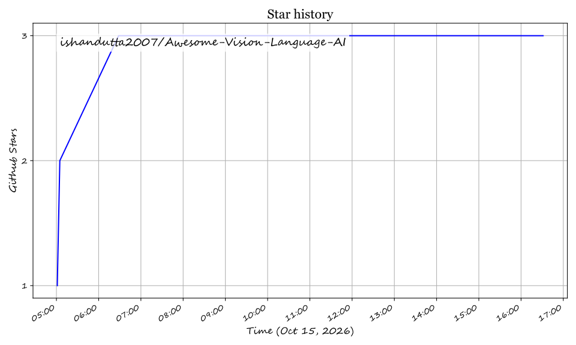

<p align="center">
  
</p>

<p align="center">
  <a href="https://github.com/ishandutta2007/Awesome-Awesome-Awesome"></a>
  <a href="https://dsscord.gg/jc4xtF58Ve"></a>
  <a href="https://github.com/ishandutta2007/Awesome-Vision-Language-AI/stargazers"></a>
  <a href="https://github.com/ishandutta2007/Awesome-Vision-Language-AI/network/members"></a>
  <a href="https://github.com/ishandutta2007/Awesome-Vision-Language-AI/pulls"></a>
  <a href="https://github.com/ishandutta2007/Awesome-Vision-Language-AI/blob/main/LICENSE"></a>
  <a href="https://github.com/ishandutta2007"></a>
</p>

---

# 👁️ Awesome Vision-Language AI

> A comprehensive, SEO-optimized, community-curated collection of **Vision-Language Models (VLMs)**, **Multimodal Large Language Models (MLLMs)**, **Zero-Shot Contrastive Encoders (CLIP/SigLIP)**, **Visual Question Answering (VQA)** toolkits, and production deployment runtimes.

Multimodal artificial intelligence bridges the divide between visual perception and natural language comprehension. This guide tracks state-of-the-art **commercial SaaS APIs** and **open-source GitHub repositories**, complete with concrete pricing tiers, free tier allowances, company scale valuations, and live GitHub popularity metrics.

---

## 📑 Table of Contents

- [🌐 Sector Overview &amp; Market Dynamics](#-sector-overview--market-dynamics)
- [🏢 SaaS &amp; Commercial Hosted Platforms](#-saas--commercial-hosted-platforms)
- [⚡ Open-Source GitHub Repositories](#-open-source-github-repositories)
  - [🏆 Repositories Sorted by Community Stars](#-repositories-sorted-by-community-stars)
  - [🧩 Key Architectural Stacks &amp; Frameworks](#-key-architectural-stacks--frameworks)
- [🛠️ How to Contribute](#️-how-to-contribute)
- [⚠️ Disclaimer](#️-disclaimer)
- [📈 Star History](#-star-history)
- [💖 Support &amp; Community](#-support--community)

---

## 🌐 Sector Overview & Market Dynamics

**Estimated Market Size**: The global Vision-Language and Multimodal AI market was valued at approximately **$8.2 billion in 2024** and is projected to surpass **$42.5 billion by 2030**, exhibiting a remarkable compound annual growth rate (**CAGR of ~31.8%**). The exponential growth is propelled by enterprise adoption across automated visual inspection, document intelligence (OCR/parsing), autonomous robotics, healthcare diagnostics, and multimodal agentic workflows.

**Market Concentration & Dynamics**: The sector demonstrates a **bifurcated market structure**:
- **Foundation Model Tier (Highly Concentrated / Winner-Take-Most)**: General-purpose frontier multimodal reasoning is dominated by hyperscalers and frontier research labs (Microsoft/OpenAI, Alphabet/Google, Amazon, and Anthropic). The immense compute clusters, petabyte-scale multimodal datasets, and post-training alignment required create substantial barriers to entry.
- **Vertical Application & Tooling Tier (Moderately Fragmented)**: Domain-specific vision pipelines, dataset management, annotation tooling, and edge inference (e.g., Roboflow, Landing AI, Clarifai) remain healthy, dynamic, and moderately fragmented. Concurrently, open-source weights (such as LLaVA, InternVL, Qwen-VL, and DeepSeek-VL) provide robust on-premise alternatives to proprietary closed-door APIs.

---

## 🏢 SaaS & Commercial Hosted Platforms

The following table compares leading commercial Vision-Language and Computer Vision SaaS providers, sorted in **descending order by company scale** (market capitalization or private valuation).

| 🏢 Platform / Service | 💼 Company &amp; Scale | 🎯 Core Focus &amp; Capabilities | 💳 Starting Tier Pricing | 🎁 Free Tier &amp; Trial Limits |
| :--- | :--- | :--- | :--- | :--- |
| **[Azure AI Vision](https://azure.microsoft.com/services/cognitive-services/computer-vision/)** | **Microsoft**<br>~$3.1T Market Cap<br>*(~$245B Ann. Rev.)* | Enterprise OCR, document reading, image analysis, smart thumbnails, content moderation, dense captioning, facial detection | **$1.00 per 1,000 transactions** (Image Analysis S0 tier); **$1.50 per 1,000 transactions** for Read/OCR ($0.001–$0.0015/image) | **F0 Free Tier**: 5,000 transactions/month free forever (up to 20 calls/min); plus **$200 credit** for 30-day trial |
| **[Google Cloud Vertex AI &amp; Gemini Vision](https://cloud.google.com/vertex-ai)** | **Alphabet / Google**<br>~$2.0T Market Cap<br>*(~$307B Ann. Rev.)* | Frontier multimodal models (Gemini 1.5 Pro &amp; Flash), native high-resolution image and video reasoning, Cloud Vision OCR, label detection | **Gemini 1.5 Flash**: **$0.075 / 1M input tokens** (~$0.00002/image); Cloud Vision API starts at **$1.50 per 1,000 units** | **Google AI Studio**: **15 RPM Free forever** (up to 1,500 requests/day); Cloud Vision: First **1,000 units/month free forever**; plus **$300 credit** for 90 days |
| **[Amazon AWS Rekognition](https://aws.amazon.com/rekognition/)** | **Amazon AWS**<br>~$1.9T Market Cap<br>*(~$575B Ann. Rev.)* | Automated image &amp; video analysis, celebrity &amp; face recognition, object/label detection, unsafe content moderation, custom labels | **$1.00 per 1,000 images** processed for the first 1M images/month ($0.001/image) across Group 1 APIs | **AWS Free Tier**: **5,000 images/month free** for the first 12 months; Custom Labels: **10 free training hrs** + **4 free inference hrs/month** for 3 months |
| **[OpenAI Vision API (GPT-4o)](https://platform.openai.com/)** | **OpenAI**<br>~$157B Valuation<br>*(~$3.7B Ann. Rev.)* | Flagship multimodal reasoning, interleaved text-and-image understanding, diagram/chart parsing, visual coding, structured JSON extraction | **GPT-4o input**: **$2.50 / 1M tokens** (~$0.001275 to $0.00255 per standard image); GPT-4o mini: **$0.15 / 1M input tokens** | Free web ChatGPT tier with dynamic daily quotas; API accounts receive **$5.00 free credit** valid for 3 months upon account verification |
| **[Anthropic Claude Vision](https://www.anthropic.com/)** | **Anthropic**<br>~$40B Valuation<br>*(~$1.0B Ann. Rev.)* | Advanced multimodal reasoning (Claude 3.5 Sonnet &amp; Haiku), chart comprehension, multi-image document synthesis, visual coding | **Claude 3.5 Haiku**: **$0.80 / 1M input tokens** (~$0.0004/image); Claude 3.5 Sonnet: **$3.00 / 1M input tokens** (~$0.0016/image) | Free web chat on claude.ai with daily message caps; **$5.00 initial free trial API credit** for console accounts |
| **[LandingLens](https://landing.ai/)** | **Landing AI**<br>~$300M Valuation<br>*(Series A, $57M raised)* | Industrial vision inspection, automated defect recognition, visual prompting, continuous model retraining, edge deployment | **Deploy Plan**: Starts at **$250/month** (billed monthly) or **$3,000/year** for cloud and edge production deployment | **Free Forever Plan**: 1 project, up to **1,000 images**, **100 model inference calls/month**, and **14-day cloud deployment trial** |
| **[Roboflow](https://roboflow.com/)** | **Roboflow**<br>~$200M Valuation<br>*(Series A, $20M+ raised)* | End-to-end computer vision platform, dataset curation, auto-labeling, foundation model fine-tuning (PaliGemma/YOLO), edge SDKs | **Starter Plan**: Starts at **$249/month** (or $199/month billed annually) for private workspaces and 10,000 inference credits/month | **Public Workspace Plan**: **100% Free forever** with up to **10,000 source images**, **3 training credits/month**, and **1,000 API inferences/month** |
| **[Clarifai](https://www.clarifai.com/)** | **Clarifai**<br>~$150M Valuation<br>*(Series C, $100M+ raised)* | Full-stack multimodal platform, visual search, custom image classifier training, auto-annotation, visual LLM pipeline orchestration | **Community Pay-As-You-Go**: Starts at **$1.20 per 1,000 operations**; Developer subscription tier at **$30/month** | **Community Free Plan**: **1,000 free operations/month forever**, up to 10 applications, 5 users, and access to all standard vision models |
| **[ViSenze](https://www.visenze.com/)** | **ViSenze**<br>~$100M Valuation<br>*(Series C, $35M+ raised)* | Retail and e-commerce visual search, visual product recommendations, automated product tagging, image-based merchandising | **Standard Plan**: Starts at **$500/month** for up to 100,000 visual search API queries/month ($0.005/query) | **30-Day Free Trial**: Includes **10,000 free search API queries** and full catalog indexing upon signup |
| **[Chooch AI](https://www.chooch.com/)** | **Chooch AI**<br>~$50M Valuation<br>*(Series A, $28M raised)* | Real-time computer vision and spatial AI, edge intelligence, industrial hazard detection, video analytics, visual alerts | **Starter Cloud API**: Starts at **$99/month** for up to 5,000 API transactions/month ($0.0198/call) | **14-Day Free Trial**: Includes **1,000 free inference API calls** and full dashboard access upon account activation |

---

## ⚡ Open-Source GitHub Repositories

The open-source vision-language ecosystem spans multimodal foundation weights, contrastive encoders, open-vocabulary detectors, and high-throughput inference engines.

### 🏆 Repositories Sorted by Community Stars

The following list is strictly sorted in **descending order by GitHub_Stars_Count**. Each repository includes a social Stars_Badge linking directly to its GitHub stargazers page.

1. **[Transformers (Hugging Face)](https://github.com/huggingface/transformers)** [](https://github.com/huggingface/transformers/stargazers)  
   The industry-standard open machine learning library providing unified implementations, weights, tokenizers, and image processors for state-of-the-art vision-language models (LLaVA, Qwen2-VL, PaliGemma, CLIP, BLIP, ViT, Idefics).

2. **[vLLM](https://github.com/vllm-project/vllm)** [](https://github.com/vllm-project/vllm/stargazers)  
   High-throughput, memory-efficient LLM and Vision-Language Model (VLM) serving engine powered by PagedAttention, chunked prefill, and native multi-image/video inference acceleration.

3. **[OpenCV](https://github.com/opencv/opencv)** [](https://github.com/opencv/opencv/stargazers)  
   The quintessential open-source computer vision library powering preprocessing, feature matching, real-time camera pipelines, and neural network runtime inferencing across global hardware.

4. **[Ultralytics (YOLOv8 / YOLO11)](https://github.com/ultralytics/ultralytics)** [](https://github.com/ultralytics/ultralytics/stargazers)  
   Industry-leading real-time computer vision framework supporting object detection, instance segmentation, pose estimation, oriented bounding boxes, and seamless multimodal vision bridges.

5. **[Segment Anything (SAM)](https://github.com/facebookresearch/segment-anything)** [](https://github.com/facebookresearch/segment-anything/stargazers)  
   Meta AI's landmark promptable image segmentation foundation model, enabling zero-shot mask generation from bounding boxes, points, and text prompts across diverse unseen domains.

6. **[Roboflow Supervision](https://github.com/roboflow/supervision)** [](https://github.com/roboflow/supervision/stargazers)  
   Composable open-source Python computer vision toolkit designed to load datasets, visualize annotations, filter detections, and benchmark outputs from any CV model or VLM.

7. **[SGLang](https://github.com/sgl-project/sglang)** [](https://github.com/sgl-project/sglang/stargazers)  
   Fast serving runtime and structured execution framework for LLMs and VLMs, featuring RadixAttention KV-cache reuse for multi-turn conversational vision and interleaved image generation.

8. **[Detectron2](https://github.com/facebookresearch/detectron2)** [](https://github.com/facebookresearch/detectron2/stargazers)  
   Meta AI Research's modular platform for high-accuracy object detection, panoptic segmentation, and dense pose estimation, frequently utilized as a visual backbone for multimodal systems.

9. **[CLIP (OpenAI)](https://github.com/openai/CLIP)** [](https://github.com/openai/CLIP/stargazers)  
   OpenAI's foundational contrastive language-image pretraining model mapping images and textual prompts into a shared high-dimensional vector space for zero-shot image classification and retrieval.

10. **[MMDetection](https://github.com/open-mmlab/mmdetection)** [](https://github.com/open-mmlab/mmdetection/stargazers)  
    OpenMMLab's comprehensive detection toolbox containing dozens of modern architectures, open-vocabulary grounding frameworks, and benchmark recipes.

11. **[MiniGPT-4](https://github.com/Vision-CAIR/MiniGPT-4)** [](https://github.com/Vision-CAIR/MiniGPT-4/stargazers)  
    Groundbreaking research demonstrating that aligning a frozen visual encoder (BLIP-2/Q-Former) with an advanced LLM (Vicuna/Llama) using a single projection layer yields emergent multimodal capabilities.

12. **[LLaVA](https://github.com/haotian-liu/LLaVA)** [](https://github.com/haotian-liu/LLaVA/stargazers)  
    Large Language and Vision Assistant—the pioneering open-source visual instruction tuning framework that established the modern VLM blueprint connecting visual encoders to auto-regressive LLMs.

13. **[Qwen2-VL / Qwen-VL](https://github.com/QwenLM/Qwen2-VL)** [](https://github.com/QwenLM/Qwen2-VL/stargazers)  
    Alibaba Cloud's premier open multimodal model family featuring dynamic image resolution processing, multilingual OCR comprehension, 20-minute video understanding, and autonomous agent device navigation.

14. **[Segment Anything 2 (SAM 2)](https://github.com/facebookresearch/sam2)** [](https://github.com/facebookresearch/sam2/stargazers)  
    Meta AI's foundation model extending visual segmentation to both static images and streaming real-time video with spatio-temporal memory attention and promptable mask propagation.

15. **[OpenCLIP](https://github.com/mlfoundations/open_clip)** [](https://github.com/mlfoundations/open_clip/stargazers)  
    Open-source contrastive vision-language pretraining framework scaling CLIP models up to ViT-Giant/14 and SigLIP architectures across billions of multilingual image-text pairs.

16. **[LAVIS](https://github.com/salesforce/LAVIS)** [](https://github.com/salesforce/LAVIS/stargazers)  
    Salesforce's comprehensive library for language-vision intelligence, offering unified interfaces for state-of-the-art multimodal foundation models, visual QA, multimodal retrieval, and captioning.

17. **[Grounding DINO](https://github.com/IDEA-Research/GroundingDINO)** [](https://github.com/IDEA-Research/GroundingDINO/stargazers)  
    State-of-the-art open-set object detector marrying DINO with grounded pre-training to localize and segment arbitrary objects based on free-form human language queries.

18. **[InternVL](https://github.com/OpenGVLab/InternVL)** [](https://github.com/OpenGVLab/InternVL/stargazers)  
    OpenGVLab's leading open-source multimodal foundation model family featuring dynamic high-resolution vision encoders, setting state-of-the-art benchmarks in document parsing, OCR, and complex chart reasoning.

19. **[CogVLM](https://github.com/THUDM/CogVLM)** [](https://github.com/THUDM/CogVLM/stargazers)  
    Powerful open vision-language model integrating deep visual-expert parameters into the language model's transformer layers, achieving pixel-level visual grounding without degrading NLP fluency.

20. **[BLIP](https://github.com/salesforce/BLIP)** [](https://github.com/salesforce/BLIP/stargazers)  
    Bootstrapping Language-Image Pre-training framework from Salesforce for unified visual understanding and generation using synthetic caption bootstrapping and noise filtering.

21. **[DeepSeek-VL2](https://github.com/deepseek-ai/DeepSeek-VL2)** [](https://github.com/deepseek-ai/DeepSeek-VL2/stargazers)  
    DeepSeek's advanced vision-language model family built on Mixture-of-Experts (MoE) architectures, delivering state-of-the-art visual reasoning, OCR, and GUI navigation at fraction of compute costs.

22. **[OpenFlamingo](https://github.com/mlfoundations/open_flamingo)** [](https://github.com/mlfoundations/open_flamingo/stargazers)  
    Open-source reproduction of DeepMind's Flamingo architecture for few-shot in-context multimodal learning across interleaved sequences of images, videos, and text.

23. **[Grounded-SAM-2](https://github.com/IDEA-Research/Grounded-SAM-2)** [](https://github.com/IDEA-Research/Grounded-SAM-2/stargazers)  
    Advanced multimodal tracking pipeline integrating Grounding DINO, Florence-2, and SAM 2 to detect, segment, and track arbitrary visual objects across video sequences using natural language queries.

24. **[Big Vision (PaliGemma / SigLIP)](https://github.com/google-research/big_vision)** [](https://github.com/google-research/big_vision/stargazers)  
    Google Research codebase for scaling vision and multimodal foundation models including PaliGemma, SigLIP (Sigmoid Loss for Language-Image Pre-Training), and Vision Transformers (ViT) in JAX/Flax.

25. **[InternLM-XComposer](https://github.com/InternLM/InternLM-XComposer)** [](https://github.com/InternLM/InternLM-XComposer/stargazers)  
    Vision-language large model tailored for high-resolution image-text comprehension, free-form interleaved text-image composition, chart analysis, and video understanding.

26. **[mPLUG-Owl](https://github.com/X-PLUG/mPLUG-Owl)** [](https://github.com/X-PLUG/mPLUG-Owl/stargazers)  
    Modular multimodal foundation model framework supporting image and video reasoning with modular visual adapters and multilingual instruction tuning.

---

### 🧩 Key Architectural Stacks & Frameworks

When engineering a custom Vision-Language AI system, teams typically assemble components from three distinct functional layers:

```
┌────────────────────────────────────────────────────────────────────────┐
│                      1. Visual Perception & Encoders                   │
│   • Contrastive Encoders: OpenAI CLIP, OpenCLIP (ViT-G/14, SigLIP)     │
│   • Dense Detectors / Segmenters: Grounding DINO, SAM 2, Detectron2    │
└───────────────────────────────────┬────────────────────────────────────┘
                                    │ Multi-scale Image Embeddings / Patches
                                    ▼
┌────────────────────────────────────────────────────────────────────────┐
│                   2. Multimodal Connectors & Adapters                  │
│   • Linear Projectors & MLPs: LLaVA 1.5/Next pattern                   │
│   • Resamplers & Cross-Attention: Q-Former (BLIP-2), Flamingo          │
└───────────────────────────────────┬────────────────────────────────────┘
                                    │ Aligned Visual Tokens
                                    ▼
┌────────────────────────────────────────────────────────────────────────┐
│                   3. Auto-Regressive Language Backbones                │
│   • Open Weights: Qwen2.5, Llama 3.1, Mistral, DeepSeek-V3             │
│   • Unified Serving Runtimes: vLLM (PagedAttention), SGLang (Radix)    │
└────────────────────────────────────────────────────────────────────────┘
```

- **High-Resolution Document Understanding & OCR**: Choose **InternVL** or **Qwen2-VL** for exceptional tabular, chart, and multilingual text parsing.
- **Open-Vocabulary Object Grounding**: Marry **Grounding DINO** with **SAM 2** (via **Grounded-SAM-2**) to detect and isolate arbitrary real-world objects via natural language prompts.
- **High-Throughput Production Inference**: Deploy open weights via **vLLM** or **SGLang** with chunked prefill, FP8 quantization, and RadixAttention KV-cache reuse.
- **Frontier Multi-Step Reasoning**: Utilize **GPT-4o**, **Claude 3.5 Sonnet**, or **Gemini 1.5 Pro** when absolute top-tier zero-shot reasoning and code synthesis are paramount.

---

## 🛠️ How to Contribute

Contributions from the multimodal and machine learning community are warmly welcomed! To add or update an entry:

1. 🍴 **Fork the repository** on GitHub.
2. 📝 **Add or edit entries in `README.md`** following the established format:
   - For SaaS products: Product Name, Hyperlink, Company & Scale, Core Capabilities, Specific Starting Price, and Specific Free Tier/Trial Limit.
   - For Open-Source repositories: Repo Name, Hyperlink, Social Stars_Badge (`style=social&color=white`) linking to its stargazers page, and a concise 1–2 sentence description. Maintain descending order by Stars_Count!
3. 🚀 **Submit a Pull Request** with a brief summary of why the addition is notable.

Check out [Awesome-Awesome-Awesome](https://github.com/ishandutta2007/Awesome-Awesome-Awesome) for more curated lists!

---

## ⚠️ Disclaimer

- This repository is a **community-curated index** created for educational, research, and technical evaluation purposes. Inclusion does not constitute an endorsement.
- Vision-Language Models can occasionally hallucinate visual facts, fail on subtle spatial boundaries, or reproduce dataset biases. Always implement human-in-the-loop review for safety-critical, medical, or regulatory applications.
- Always review each platform's data retention policies, privacy protections, and compliance terms before transmitting sensitive visual assets (e.g., PII, medical imagery, proprietary documentation).

---

## 📈 Star History

[](https://star-history.dera.page/#ishandutta2007/Awesome-Vision-Language-AI&type=date&legend=top-left)

---

## 💖 Support & Community

Thank you for exploring **Awesome Vision-Language AI**! Multimodal artificial intelligence is evolving at breakneck speed, and this repository is continuously maintained to help researchers, machine learning engineers, and developers stay at the forefront of vision-language technology.

If you find this repository valuable, please consider supporting the project:

- ⭐ **Star this repository** to help others discover it and track new updates.
- 🍴 **Fork the repo** to build your own custom curated vision-language toolkits.
- 📢 **Share with your network** on Twitter/X, LinkedIn, Reddit, or Discord.
- 🤝 **Contribute** by opening pull requests for new foundation models, benchmarks, or toolkits.
- ☕ **Buy a coffee & sponsor**: If this project saves you engineering hours, consider sponsoring via the [GitHub Sponsors Dashboard](https://github.com/sponsors/ishandutta2007) to support continuous updates and community maintenance!

<p align="center">
  <a href="https://github.com/sponsors/ishandutta2007">
    
  </a>
</p>

## Star History

<a href="https://star-history.com/#ishandutta2007/Awesome-Vision-Language-AI&Timeline" align="center">
  <picture>
    <source media="(prefers-color-scheme: dark)" srcset="assets/ishandutta2007_Awesome-Vision-Language-AI_growth.svg">
    
  </picture>
</a>
